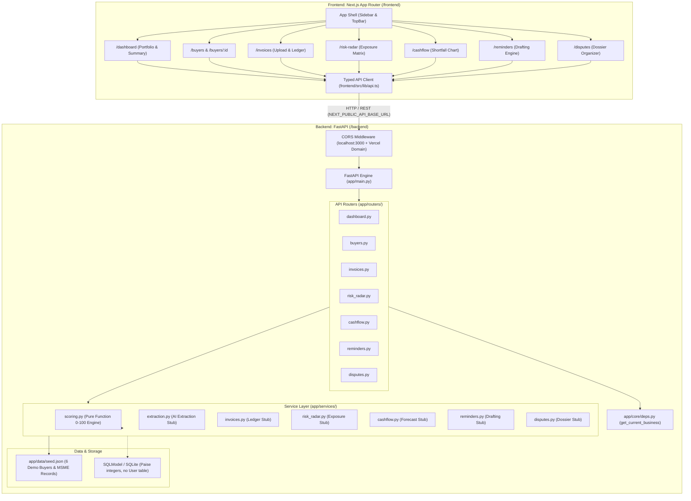

# Architecture & Data Flow: Payflow AI

## 1. System Architecture Overview



---

## 2. Data Flow Principles

1. **Client Ingestion**: The Next.js frontend calls the backend strictly via methods in `frontend/src/lib/api.ts`.
2. **Context Independence**: Routers receive HTTP requests without auth tokens. Every router invokes `get_current_business()` from `app/core/deps.py` to retrieve the seeded supplier business entity.
3. **Mock Switch**: When `USE_MOCK_DATA=true` (the default for rapid local prototyping and test suites), services directly return structured payloads matching `app/data/seed.json` and Pydantic schemas.
4. **Scoring Pipeline**:
   - `services/scoring.py` is implemented as a pure mathematical function.
   - It takes a buyer's invoices, payment records, and payment commitments.
   - It computes the 5 sub-scores (`on_time`, `delay`, `consistency`, `commitments`, `overdue_history`), applies dynamic weight reallocation if commitments are absent, checks minimum settled thresholds, and yields the final composite 0-100 score and tier label.

---

## 3. Directory Layout

```
Payflow.AI/
├── AGENTS.md                  # Master instructions for all agents
├── CLAUDE.md                  # Claude agent pointer
├── GEMINI.md                  # Gemini agent pointer
├── .github/copilot-instructions.md
├── README.md                  # Setup & architecture summary
├── CONTRIBUTING.md            # Guidelines for team collaboration
├── docs/                      # Complete technical specifications
│   ├── PRODUCT.md
│   ├── ARCHITECTURE.md
│   ├── DATA_MODEL.md
│   ├── API_CONTRACT.md
│   ├── SCORING_SPEC.md
│   ├── UI_DESIGN_SYSTEM.md
│   ├── FEATURES.md
│   └── DECISIONS.md
├── design/stitch-exports/     # Exported designs and mockups
├── frontend/                  # Next.js 14/15 App Router app
│   ├── src/app/               # App Router pages (/dashboard, /buyers, etc.)
│   ├── src/components/        # UI components & layouts
│   ├── src/lib/api.ts         # Typed API client
│   └── src/lib/types.ts       # Typed contract definitions
└── backend/                   # FastAPI backend
    ├── app/main.py            # App initialization, CORS, routing
    ├── app/core/config.py     # Pydantic Settings
    ├── app/core/deps.py       # get_current_business() dependency
    ├── app/models/            # SQLModel database tables
    ├── app/schemas/           # Pydantic v2 schemas
    ├── app/routers/           # API endpoints
    ├── app/services/          # Service layer (stubs + scoring baseline)
    ├── app/data/seed.json     # Seed dataset
    └── tests/                 # pytest unit & API tests
```
