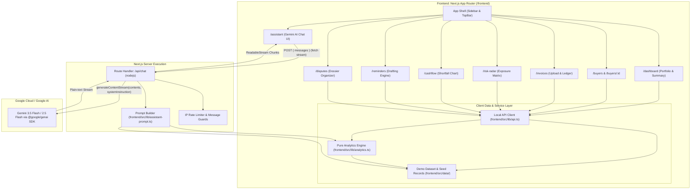

# Architecture & Data Flow: Payflow AI

## 1. System Architecture Overview



---

## 2. Core Architecture Principles

1. **No External Backend or Database**:
   - The application runs purely as a Next.js App Router project deployed to Vercel (Root Directory: `frontend`).
   - Demo ledger data is pre-seeded with verified MSME business records anchored to a fixed `AS_OF_DATE = "2026-10-31"`.
2. **Instant Local Data Client**:
   - The typed client in `frontend/src/lib/api.ts` provides uniform asynchronous interfaces (`getDashboardSummary`, `getBuyers`, `getBuyerScore`, `getInvoices`, etc.) reading directly from local typed memory.
   - All UI charts, gauges, tables, and badge components work without network dependency.
3. **Pure Derived Analytics (`analytics.ts`)**:
   - All aggregations (total receivables, overdue aging, shortfall risks, priority rankings) are implemented as pure mathematical functions.
   - Standard priority formula:
     $$\text{Priority Score} = 0.50 \times \left(\frac{\text{Overdue}}{\text{Max Overdue}}\right) + 0.30 \times \left(\frac{\text{Oldest Days}}{\text{Max Days}}\right) + 0.20 \times \left(\frac{100 - \text{Score}}{100}\right)$$
4. **Secure AI Chat Assistant (`/api/chat`)**:
   - Built with the official `@google/genai` TypeScript SDK.
   - Grounded with `COMPUTED_FACTS` so the LLM never performs mental math.
   - Rate limited (20 req/min per IP) and protected by character limits (max 1,000 chars per message).
   - If `GEMINI_API_KEY` is not present, returns a friendly 200 fallback message rather than crashing.

---

## 3. Directory Layout

```
Payflow.AI/
├── AGENTS.md                  # Master instructions for all agents
├── CLAUDE.md                  # Claude agent pointer
├── GEMINI.md                  # Gemini agent pointer
├── .github/copilot-instructions.md
├── README.md                  # Setup & architecture summary
├── CONTRIBUTING.md            # Guidelines for team collaboration
├── docs/                      # Complete technical specifications
│   ├── PRODUCT.md             # Problem space, personas, features, non-goals
│   ├── ARCHITECTURE.md        # Architecture diagram & data flow
│   ├── DATA_MODEL.md          # TypeScript models & ledger entities
│   ├── AI_ASSISTANT.md        # Gemini prompt design, priority formula & demo QA
│   ├── SCORING_SPEC.md        # Mathematical scoring rules & weights
│   ├── UI_DESIGN_SYSTEM.md    # Colors, fonts, tokens & wording rules
│   └── DECISIONS.md           # Architecture Decision Records (ADRs)
├── design/stitch-exports/     # Stitch UI design references
└── frontend/                  # Next.js App Router application
    ├── src/app/               # App Router pages (/dashboard, /assistant, etc.)
    │   ├── api/chat/route.ts  # Streaming Gemini route handler
    │   ├── assistant/page.tsx # AI chat interface
    │   └── ...
    ├── src/components/        # UI components
    ├── src/data/              # Single source of truth demo data
    ├── src/lib/analytics.ts   # Pure derived ledger metrics
    ├── src/lib/assistant-prompt.ts # Gemini system prompt builder
    ├── src/lib/api.ts         # Typed local data client
    └── src/lib/types.ts       # Shared TypeScript interfaces
```
