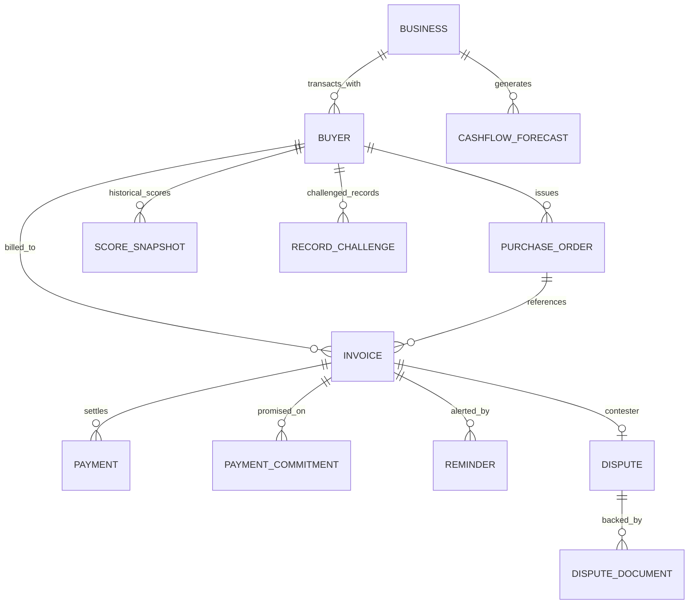

# Data Model Specification: Payflow AI

## 1. Storage & Currency Conventions

1. **Monetary Unit**: All monetary fields are stored as **integers in paise** (`1 INR = 100 paise`). For example, ₹50,000 is represented as `5000000`. This completely eliminates floating-point rounding errors.
2. **Timestamps**: All dates and timestamps are stored in ISO 8601 UTC format (`YYYY-MM-DD` or `YYYY-MM-DDTHH:MM:SSZ`), anchored to the fixed ledger date `AS_OF_DATE = "2026-10-31"`.
3. **No User Model**: There is strictly **no User table**. Single-tenancy operates via the single seeded `Business` record (`Kaveri Industrial Supplies`).
4. **Implementation**: Entities are declared as TypeScript interfaces in `frontend/src/lib/types.ts` and hydrated directly from `frontend/src/data/seed.json`.

---

## 2. Entity Relationship Overview

---

## 3. Detailed Entity Definitions

### 3.1 Business (Single Seeded Counterparty)
Represents the MSME supplier using Payflow AI (`Kaveri Industrial Supplies`).
- `id`: `string` (`"biz_demo_001"`)
- `name`: `string` (`"Kaveri Industrial Supplies"`)
- `legal_name`: `string` (`"Kaveri Industrial Supplies & Engineering Pvt. Ltd."`)
- `gstin`: `string` (`"27AABCU9603R1ZM"`)
- `city`: `string` (`"Pune"`)
- `state`: `string` (`"Maharashtra"`)
- `created_at`: `string`

### 3.2 Buyer
Represents a corporate or wholesale buyer purchasing goods/services on credit.
- `id`: `string` (e.g., `"buyer_01"`, `"buyer_05"`)
- `business_id`: `string`
- `name`: `string` (e.g., `"Global Distributors"`, `"ABC Industries"`)
- `gstin`: `string`
- `contact_person`: `string`
- `email`: `string`
- `phone`: `string`
- `agreed_terms_days`: `number` (Agreed credit period, e.g. 30, 45 days)
- `reliability_score`: `number | null` (0–100 score; `null` if < 3 settled invoices)
- `reliability_tier`: `string` (`"Highly reliable"`, `"Reliable"`, `"Moderate reliability"`, `"Needs attention"`, `"High payment risk"`, `"Insufficient history"`)
- `outstanding_exposure_paise`: `number` (Total unpaid invoices in paise)
- `overdue_paise`: `number`
- `average_delay_days`: `number`
- `transactions_count`: `number`

### 3.3 Invoice
Represents a commercial invoice issued to a buyer.
- `id`: `string` (e.g., `"inv_005"`)
- `invoice_number`: `string` (e.g., `"INV-2026-005"`)
- `buyer_id`: `string`
- `amount_paise`: `number` (Total invoice value in paise)
- `paid_amount_paise`: `number`
- `issue_date`: `string`
- `due_date`: `string`
- `payment_terms_days`: `number`
- `status`: `string` (`"DRAFT"`, `"SENT"`, `"PARTIALLY_PAID"`, `"PAID"`, `"OVERDUE"`, `"DISPUTED"`)
- `overdue_days`: `number` (Days past `due_date` relative to `AS_OF_DATE`)
- `notes`: `string`

### 3.4 Dispute & Dispute Documents
Formal record of invoice disputes isolated from the Buyer Reliability Score.
- `id`: `string` (`"disp_001"`)
- `invoice_id`: `string` (`"inv_004"`)
- `buyer_id`: `string` (`"buyer_04"`)
- `dispute_category`: `string` (`"Delayed Payment Refusal"`)
- `status`: `string` (`"UNDER_REVIEW"`, `"RESOLVED"`, `"ESCALATED"`)
- `amount_disputed_paise`: `number`
- `reason`: `string`
- `dossier_ready`: `boolean`

### 3.5 Reminder
Tone-calibrated follow-up notice drafted across channels.
- `id`: `string`
- `invoice_id`: `string`
- `buyer_id`: `string`
- `channel`: `string` (`"WHATSAPP"`, `"EMAIL"`, `"POSTAL_NOTICE"`)
- `tone`: `string` (`"GENTLE"`, `"FIRM"`, `"URGENT"`, `"LEGAL"`)
- `status`: `string` (`"DRAFT"`, `"QUEUED"`, `"SENT"`)
- `subject`: `string`
- `message_body`: `string`
