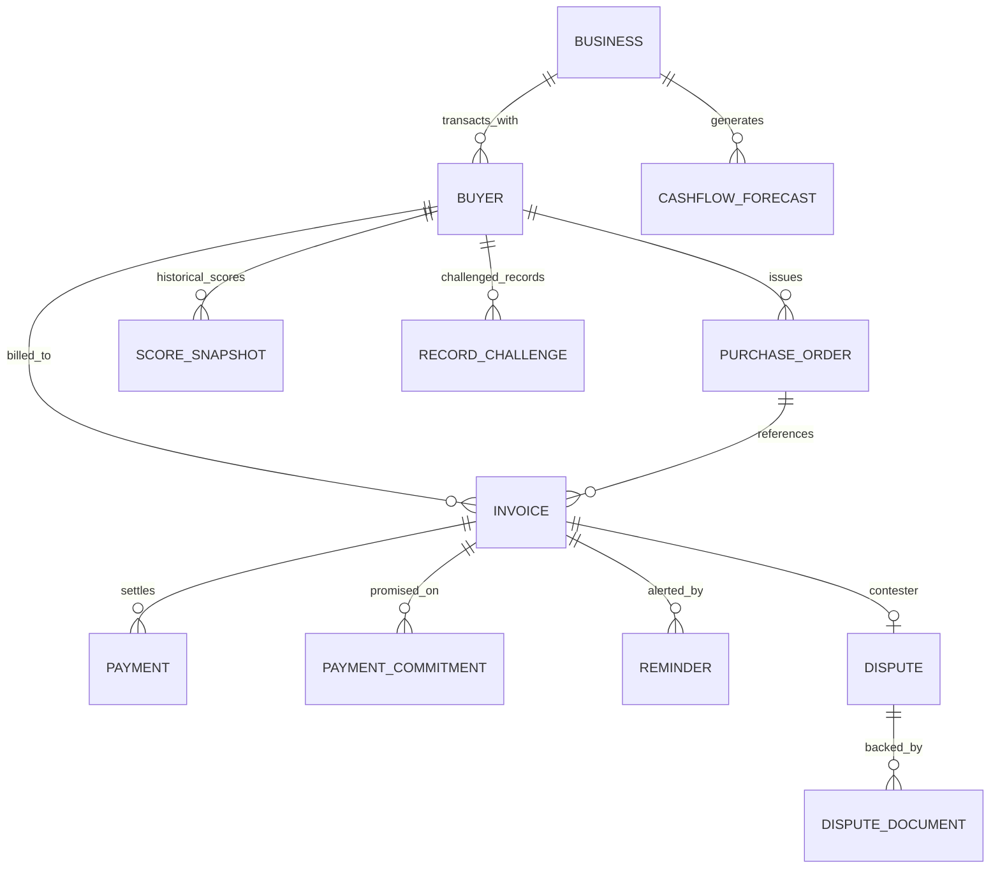

# Data Model Specification: Payflow AI

## 1. Storage & Currency Conventions

1. **Monetary Unit**: All monetary fields are stored as **integers in paise** (`1 INR = 100 paise`). For example, ₹50,000 is stored as `5000000`. This prevents floating-point inaccuracies.
2. **Timestamps**: All dates and timestamps are stored in ISO 8601 UTC format (`YYYY-MM-DD` or `YYYY-MM-DDTHH:MM:SSZ`).
3. **No User Model**: There is strictly **no User table**. Single-tenancy operates via the single seeded `Business` record.

---

## 2. Entity Relationship Overview

---

## 3. Detailed Entity Definitions

### 3.1 Business (Single Seeded Row)
Represents the MSME supplier using Payflow AI.
- `id`: `str` (Primary Key, e.g., `"biz_demo_001"`)
- `name`: `str` (e.g., `"Kaveri Industrial Supplies"`)
- `legal_name`: `str` (e.g., `"Kaveri Industrial Supplies & Engineering Pvt. Ltd."`)
- `gstin`: `str` (15-character GSTIN, e.g., `"27AABCU9603R1ZM"`)
- `pan`: `str`
- `msme_reg_no`: `Optional[str]` (UDYAM registration number)
- `city`: `str`
- `state`: `str`
- `created_at`: `datetime`

### 3.2 Buyer
Represents a corporate or wholesale buyer purchasing goods/services on credit.
- `id`: `str` (Primary Key, e.g., `"buyer_01"`)
- `business_id`: `str` (Foreign Key -> Business.id)
- `name`: `str` (e.g., `"ABC Industries"`)
- `gstin`: `Optional[str]`
- `contact_person`: `Optional[str]`
- `email`: `Optional[str]`
- `phone`: `Optional[str]`
- `agreed_terms_days`: `int` (Default credit period, e.g., `30`, `45`)
- `address`: `Optional[str]`
- `reliability_score`: `Optional[float]` (Current composite score 0-100; null if < 3 invoices)
- `reliability_tier`: `str` (`"Highly reliable"`, `"Reliable"`, `"Moderate reliability"`, `"Needs attention"`, `"High payment risk"`, `"Insufficient history"`)
- `outstanding_exposure_paise`: `int` (Total unpaid invoices in paise)
- `average_delay_days`: `float`
- `transactions_count`: `int`
- `created_at`: `datetime`
- `updated_at`: `datetime`

### 3.3 PurchaseOrder
Represents the buyer's purchase order authorization.
- `id`: `str` (Primary Key)
- `buyer_id`: `str` (Foreign Key -> Buyer.id)
- `po_number`: `str` (e.g., `"PO-2026-9912"`)
- `po_date`: `date`
- `total_amount_paise`: `int`
- `file_url`: `Optional[str]`
- `status`: `str` (`"ISSUED"`, `"FULFILLED"`, `"CANCELLED"`)

### 3.4 Invoice
Represents a tax invoice issued by the MSME to the buyer.
- `id`: `str` (Primary Key, e.g., `"inv_001"`)
- `buyer_id`: `str` (Foreign Key -> Buyer.id)
- `po_id`: `Optional[str]` (Foreign Key -> PurchaseOrder.id)
- `invoice_number`: `str` (e.g., `"INV-2026-081"`)
- `issue_date`: `date`
- `payment_terms_days`: `int` (Terms specific to this invoice, e.g. 30)
- `due_date`: `date` (`issue_date + payment_terms_days`)
- `amount_paise`: `int` (Total invoice value in paise)
- `paid_amount_paise`: `int` (Cumulative settled amount in paise)
- `status`: `str` (`"PAID"`, `"UNPAID"`, `"OVERDUE"`, `"PARTIALLY_PAID"`, `"DISPUTED"`)
- `overdue_days`: `int` (0 if not overdue, otherwise `today - due_date`)
- `is_disputed`: `bool` (Default `False`)
- `created_at`: `datetime`

### 3.5 Payment
Represents an incoming transaction settling full or partial invoice balance.
- `id`: `str` (Primary Key)
- `invoice_id`: `str` (Foreign Key -> Invoice.id)
- `amount_paise`: `int`
- `paid_date`: `date`
- `payment_mode`: `str` (`"NEFT"`, `"RTGS"`, `"UPI"`, `"CHEQUE"`)
- `reference_number`: `Optional[str]` (UTR / Transaction ID)
- `delay_days`: `int` (Difference between `paid_date` and `invoice.due_date`; negative means paid early)

### 3.6 PaymentCommitment
Represents a buyer's promise to pay by a specific date.
- `id`: `str` (Primary Key)
- `invoice_id`: `str` (Foreign Key -> Invoice.id)
- `buyer_id`: `str` (Foreign Key -> Buyer.id)
- `promised_date`: `date`
- `kept`: `Optional[bool]` (`True` if paid by promised date, `False` if missed, `None` if pending)
- `notes`: `Optional[str]` (e.g., `"Accounts officer promised NEFT clearance by Friday"`)
- `created_at`: `datetime`

### 3.7 Dispute
Represents an active contestation or hold on an invoice.
- `id`: `str` (Primary Key)
- `invoice_id`: `str` (Foreign Key -> Invoice.id, Unique)
- `buyer_id`: `str` (Foreign Key -> Buyer.id)
- `reason`: `str` (`"DAMAGED_GOODS"`, `"RATE_DISCREPANCY"`, `"QUANTITY_SHORTAGE"`, `"DELIVERY_DELAY"`, `"TAX_INVOICE_ERROR"`, `"OTHER"`)
- `status`: `str` (`"OPEN"`, `"IN_REVIEW"`, `"RESOLVED"`, `"ESCALATED"`)
- `disputed_amount_paise`: `int`
- `notes`: `str`
- `opened_at`: `datetime`
- `resolved_at`: `Optional[datetime]`

### 3.8 DisputeDocument
Supporting documentary evidence (e.g., Lorry Receipt, Quality Inspection Report, email export).
- `id`: `str` (Primary Key)
- `dispute_id`: `str` (Foreign Key -> Dispute.id)
- `file_name`: `str`
- `file_url`: `str`
- `document_type`: `str` (`"PURCHASE_ORDER"`, `"DELIVERY_CHALLAN"`, `"LR_COPY"`, `"EMAIL_THREAD"`, `"INSPECTION_NOTE"`)
- `uploaded_at`: `datetime`

### 3.9 Reminder
Communication dispatch record for payment collection.
- `id`: `str` (Primary Key)
- `invoice_id`: `str` (Foreign Key -> Invoice.id)
- `buyer_id`: `str` (Foreign Key -> Buyer.id)
- `channel`: `str` (`"WHATSAPP"`, `"EMAIL"`, `"SMS"`)
- `tone`: `str` (`"GENTLE"`, `"FIRM"`, `"FORMAL_DEMAND"`, `"LEGAL_NOTICE"`)
- `subject`: `Optional[str]`
- `body`: `str`
- `sent_at`: `Optional[datetime]`
- `status`: `str` (`"DRAFT"`, `"SENT"`, `"DELIVERED"`, `"FAILED"`)

### 3.10 RecordChallenge
Suppliers can flag an erroneous ledger entry (e.g., buyer claims early RTGS, or bank reconciliation delay).
- `id`: `str` (Primary Key)
- `buyer_id`: `str` (Foreign Key -> Buyer.id)
- `invoice_id`: `Optional[str]`
- `payment_id`: `Optional[str]`
- `reason`: `str`
- `proposed_correction`: `str`
- `status`: `str` (`"PENDING"`, `"ACCEPTED"`, `"REJECTED"`)
- `created_at`: `datetime`

### 3.11 ScoreSnapshot
Historical log of Buyer Reliability Scores for trend analysis.
- `id`: `str` (Primary Key)
- `buyer_id`: `str` (Foreign Key -> Buyer.id)
- `score`: `float`
- `tier`: `str`
- `on_time_subscore`: `float`
- `delay_subscore`: `float`
- `consistency_subscore`: `float`
- `commitments_subscore`: `Optional[float]`
- `overdue_history_subscore`: `float`
- `transactions_count`: `int`
- `snapshot_date`: `date`

### 3.12 CashflowForecast
Aggregate cash projections over 30/60/90 days.
- `id`: `str` (Primary Key)
- `forecast_date`: `date`
- `projected_inflow_paise`: `int`
- `expected_delayed_paise`: `int`
- `projected_shortfall_paise`: `int`
- `confidence_score`: `float`
- `created_at`: `datetime`
